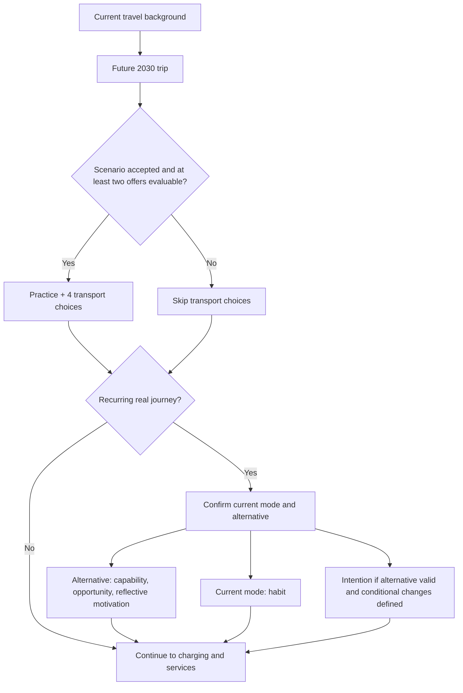
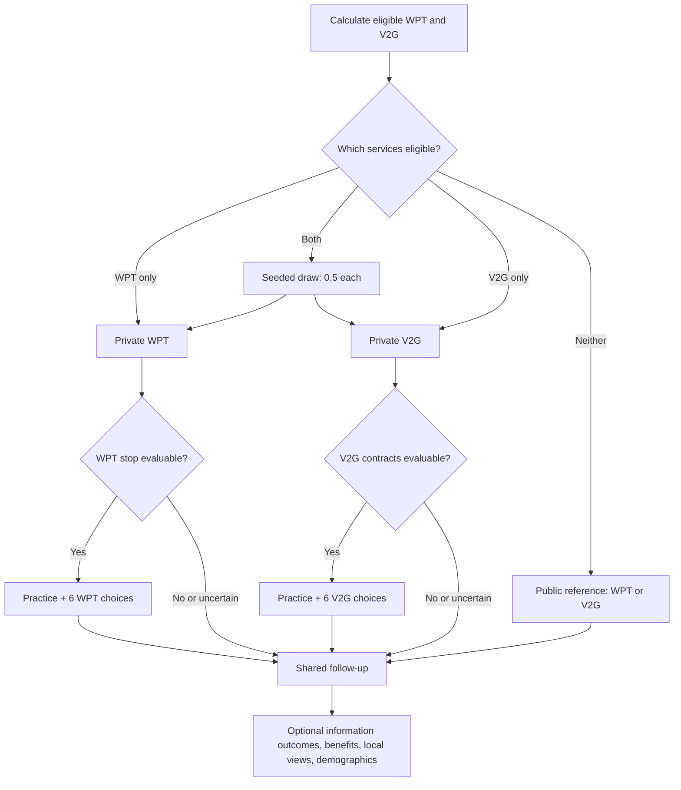

# Current routing and compact presentation

Instrument: `pulse-v2-A0.9-test-2026-11-04`. Compact layout: `compact-2026-11-06`.

The routing source remains `public/v2/engine.mjs`. `layout.mjs` only combines consecutive question pages; it does not calculate eligibility. `survey.json`, its fingerprint, wording, response options, construct membership and proposed DCE profiles are unchanged.

The public partner reference is `/v2/routing.html`, linked inside **Partner test links** on the welcome screen. Its four SVGs show mobility, charging, default service assignment and the separate driver-comparison option. Regenerate them with `python3 scripts/make-routing-figures.py`; ReportLab is needed only for figure generation. Add `--pdf /private/path/PULSE_v2_Current_Routing.pdf` for the printable guide.

## Mobility and transport

The transport decision is `B-TRIP-CONTEXT !== 97` and at least two evaluable codes among 1-3 in `B-MODE-EVAL`. A refusal to state trip purpose (99) does not by itself remove choices. Usual weekly modes do not automatically mask hypothetical offers. The all-or-none exclusive answers in `B-MODE-EVAL` give no evaluable offers.

`A-JRN-01=1..4` enables the recurring-journey path. `A-JRN-02=1..8` enables current-mode habit. An alternative is confirmed through `C-ALT-01=1..5`, `C-ALT-01=6` plus `C-ALT-USED=1..5`, or `C-ALT-01=97` plus `C-ALT-02=1..5`. In the last case, intentions/future frequency require a non-empty `C-COND-01` containing only named-change codes 1-7. Capability/opportunity/reflection concern current circumstances; unspecified improvements are not treated as an intention forecast. No alternative still permits current-mode habit and its relevant barriers.

## Current charging versus service eligibility

| Input | Condition | Result |
| --- | --- | --- |
| `A-MOB-01` / `A-MOB-PRIMARY` | Car driver already reported | Skip duplicate `R-DRIVE-01`; derive driving |
| `A-PRO-DRIVE-01` | 1 or 2 | Ask work powertrains `A-PRO-PT-01`; this is separate from household access |
| `A-VEH-ACCESS-01` | 1 or 2 | Household vehicle access; ask household powertrains |
| `A-HH-PT-01` | Contains 1 (BEV) or 2 (PHEV), plus household access | Ask `A-CHG-ROLE` |
| `A-CHG-ROLE` | 1 or 2 | Ask actual charging locations and relevant details |
| `A-CHG-LOC` | One substantive location | Derive main location |
| `A-CHG-LOC` | Two or more substantive locations | Ask `A-CHG-MAIN`, filtered to those locations |
| Household access OR `A-FUT-ROLE=1` | True | Household/future evaluation context; private service eligibility remains subject to the service-specific evaluation answer |
| `F-EVAL-W=1` plus household/future context | True | WPT privately eligible |
| `F-EVAL-V=1` plus household/future context | True | V2G privately eligible |

All respondents see neutral WPT and V2G descriptions and answer both evaluation questions. BEV/PHEV access controls actual charging history, not hypothetical future service eligibility. Non-drivers and non-car citizens can qualify through a household/future role. Those without a privately evaluable service remain on the public/non-user route.

## One technology and shared follow-up

Dual private eligibility uses a seeded 1:1-probability assignment. Single eligibility assigns that technology. No private eligibility assigns a public reference concept with 0.5 probability each. `?technology=wpt` or `?technology=v2g` is a recorded review override; on a private route it is honoured only when that service is eligible. Public overrides set the reference concept.

The context gate controls only the technology DCE: `G-WPT-CONTEXT-01=1` or `G-V2G-CONTEXT-01=1`. Uncertainty, refusal or No skips those choices while retaining private acceptance and downstream reflection. The ordinary path has at most ten scored tasks plus two practices. Everyone can receive benefit importance and local impacts; the public route also receives public support/attitude items.

## Optional comparison of both DCEs for drivers

The partner link `/v2/?dce=both-drivers` adds the optional Boolean setting `review_both_dce=true`. It has a separate session-storage key through its settings. The default settings object is unchanged, so older saved responses remain supported.

Both technology DCEs are available only when `derive().driving === 1` and both services are privately eligible. Current driving is established by usual-mode reports or `R-DRIVE-01`, not by having a driving licence or by work powertrain alone. The assigned service remains the primary one and is compared first. Dual eligibility gives it a 0.5/0.5 seeded probability in the absence of a review override. Only its acceptance battery is shown. The second service receives a fresh concept/scenario, its relevant comprehension checks and its own context gate. A failed first context does not prevent evaluating the second service.

After the second comparison, an explicit return-to-primary introduction restores the referent for information outcomes, benefits and reflections. The review can show all 19 proposed task cards: four transport and twelve technology scored tasks, plus three practices. It is a longer instrument-review option, not the ordinary single-technology design.

Non-car/non-driver respondents retain transport choices when evaluable, and an assigned technology service where a household or realistic future role makes it meaningful. They otherwise retain public/non-user views. The driver-review flag alone does not force both technology blocks on them, and context uncertainty can still skip a DCE.

Stored review records retain the flag, primary service, secondary service, actual technology choice blocks and task order. Python exports `dce_review_mode` as metadata; each choice row's `block` identifies the service. Review and ordinary modes should be separated in burden and preference analysis. Primary TAM feature tables still refer to the assigned service; no second acceptance battery is imputed.

Information, ranking, values, prosumer, convenience and extra conditions are off by default. When information is enabled, a separate seeded 1:1-probability draw occurs after DCE/context skip. Its outcomes precede shared benefit labels. Layout grouping never crosses that experimental boundary. The selected test site is questionnaire context, not verified residence. Parking access, affordability and demographics are descriptive; they do not set the private technology allocation.

## Presentation and timing compatibility

New sessions carry `layout_version=compact-2026-11-06`. Sessions without a layout field retain the original page sequence; `pages-2026-11-04` is their analytic label. Existing answers, notes, receipts and timing are preserved. Start another test to use the new grouped pages after completing an earlier-layout round.

Grids share a header only when the complete ordered code/label sets match. Capability, habit, intention, acceptance, trust, diagnostics and benefit importance retain their separate item/construct identities. Current-mode habit is not grouped with alternative-mode intention. Rating groups contain at most six rows; optional values retain original item order in groups of four, four and five. Desktop uses statement rows and option columns. On narrow screens, each statement has compact numeric choices and fully labelled non-response choices; a scale key stays above each rating block.

The Worker validates compact page and driver-review timing IDs and retains optional layout/mode metadata in the existing JSON payload. No D1 columns or migrations are introduced. Python tables include layout and DCE review mode; MATLAB excludes both from feature columns and remains compatible with earlier prepared tables. Compare observed completion times by layout and review mode before drawing burden conclusions; fewer pages alone does not establish a time reduction.
